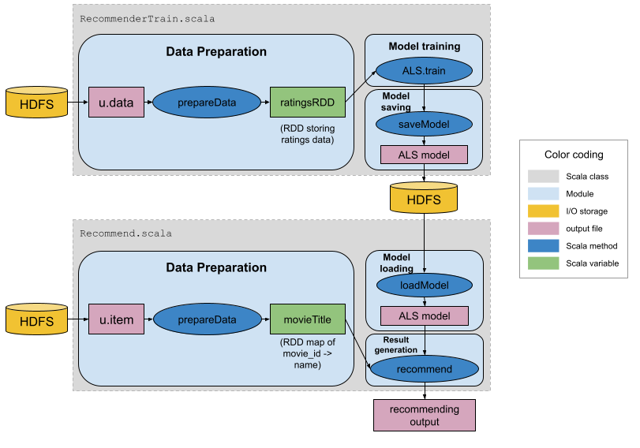
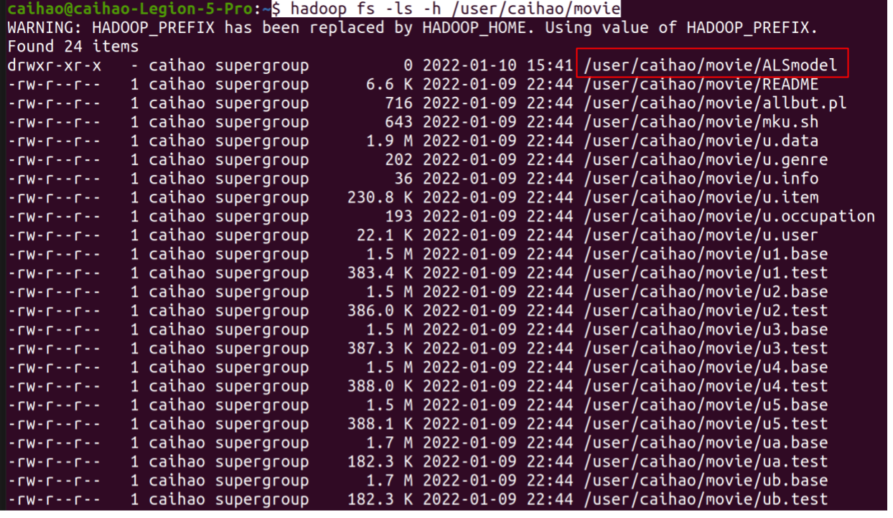
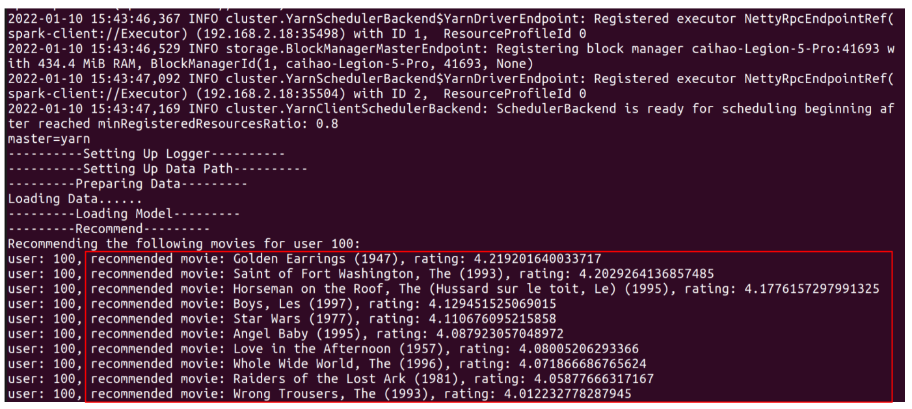
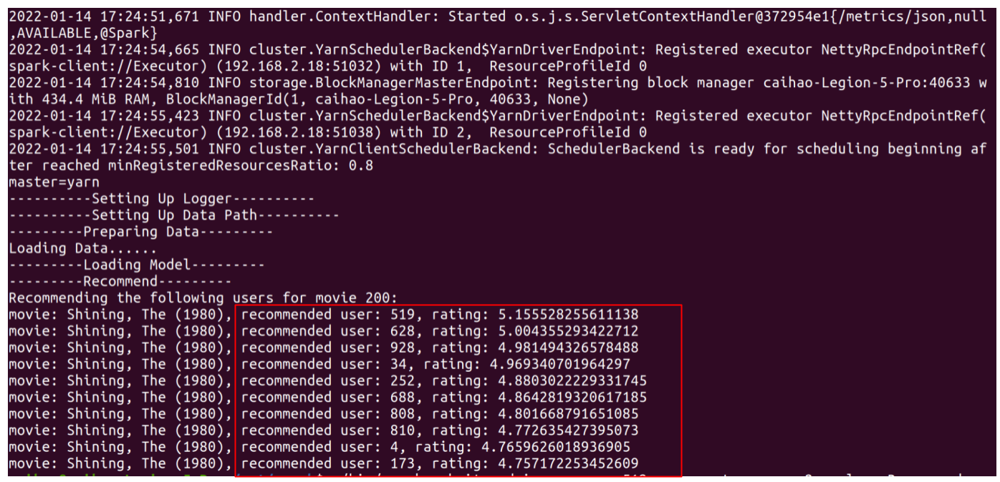

# Movie Recommender


This movie recommendation system uses Scala and PySpark. It trains a collaborative-filtering model with **Alternating Least Squares (ALS)** from Spark MLlib on the **MovieLens 100K** dataset, stores data and models on **Hadoop HDFS**, and then:

- recommends the top 10 movies for a given user (`--U <userId>`), or
- recommends the top 10 users for a given movie (`--M <movieId>`).



---

## Tech stack and why it was chosen

| Layer | Technology | Version | Why it is used |
|---|---|---|---|
| Language | **Scala** | 2.12.15 | Spark is written in Scala, so Scala gets Spark's native, type-safe API with no Python↔JVM serialization overhead. 2.12 is the Scala line that most Spark 3.x distributions and Databricks runtimes ship with. |
| Runtime | **JVM (Java 8 or 11)** | 8 / 11 | Scala and Spark run on the JVM. Spark 3.2 officially supports Java 8 and 11. |
| Distributed compute | **Apache Spark Core** | 3.2.0 | `SparkContext` and RDDs split loading, parsing and model training across cores or cluster nodes. The same code runs on a laptop (`local[*]`) or on a cluster (YARN/standalone). |
| Machine learning | **Spark MLlib (`mllib.recommendation`)** | 3.2.0 | Provides a ready-made, distributed **ALS** matrix-factorization implementation (`ALS.train`, `MatrixFactorizationModel`). ALS is a standard algorithm for explicit-rating collaborative filtering. Its alternating solves parallelize well, and the trained model can be saved and loaded with `save`/`load`. |
| Algorithm | **ALS matrix factorization** | rank=5, iterations=20, λ=0.1 | Splits the sparse user × movie rating matrix into low-rank user and item factor matrices. The product of the two predicts ratings for movies a user has not seen. It works with only the rating data (no content features needed). See `imgs/.../matrix-factorization.png`. |
| Storage | **Hadoop HDFS** | 2.x / 3.x | Stores the input data (`u.data`, `u.item`), the saved ALS model and the Spark checkpoint directory. It is the default distributed file system for Spark, so every executor can read the same files. The saved model persists between the training run and the recommendation run. |
| Build tool | **sbt** | 1.6.1 (`project/build.properties`) | sbt is the standard Scala build tool. `build.sbt` declares the Scala version and Spark dependencies, and `sbt package` produces the jar that `spark-submit` runs. |
| IDE / packaging | **IntelliJ IDEA + Scala plugin** | — | Used to develop the project and to build jar artifacts. `src/main/scala/META-INF/MANIFEST.MF` sets the jar's `Main-Class` (`Recommend`) so the jar can run without `--class`. |
| Logging | **Apache Log4j** (bundled with Spark) | 1.x | `setLogger()` lowers `org` / `akka` loggers to `ERROR` so Spark's verbose INFO output does not bury the recommendations. |
| Notebook (Python) | **PySpark** | 3.x | `pyspark_databricks_notebook/MovieRecommender.ipynb` repeats the pipeline in Python (`pyspark.mllib.recommendation`) for quick, interactive experiments without compiling. |
| Notebook platform | **Databricks / Jupyter** | — | The notebooks run on Databricks, which provides a managed Spark cluster, or on any Jupyter install with PySpark. `MovieRecommenderDemo.scala` is a step-by-step exploration script that also shows how to read and write HDFS. |
| Dataset | **MovieLens 100K** (GroupLens) | ml-100k | A small, widely used benchmark: 100,000 ratings (1–5) from 943 users on 1,682 movies. It is big enough to be realistic and small enough to train in seconds. |
| Fault tolerance | **Spark checkpointing** | — | `sc.setCheckpointDir` + `rdd.checkpoint()` truncate the RDD lineage. Without this, ALS's iterative lineage can cause a `StackOverflowError` on long runs. |

---

## Project layout

```
MovieRecommender/
├── build.sbt                         # sbt build: Scala version + Spark dependencies
├── project/build.properties          # pins sbt version (1.6.1)
├── src/main/scala/
│   ├── RecommenderTrain.scala        # trains ALS on u.data and saves the model
│   ├── Recommend.scala               # loads the model and prints recommendations
│   └── META-INF/MANIFEST.MF          # Main-Class for IntelliJ-built jar
├── pyspark_databricks_notebook/
│   ├── MovieRecommender.ipynb        # PySpark version (Databricks / Jupyter)
│   └── MovieRecommenderDemo.scala    # exploratory Scala walkthrough (not part of the sbt build)
└── imgs/                             # documentation images
```

---

## Prerequisites

- **Java 8 or 11** (JDK)
- **sbt 1.6.x** (to build)
- **Apache Spark 3.2.x** (`spark-submit` on your `PATH`)
- **Hadoop HDFS** running at `hdfs://localhost:9000`. This is optional: you can use local files instead (see below).
- **MovieLens 100K**: download `ml-100k.zip` from https://grouplens.org/datasets/movielens/100k/ and extract it.

> **Windows:** Spark/Hadoop need `winutils.exe` and the `HADOOP_HOME` environment variable set. Running under WSL is usually simpler.

## Configuration

Both Scala apps read file locations from environment variables and fall back to HDFS defaults:

| Variable | `RecommenderTrain` default | `Recommend` default |
|---|---|---|
| `MOVIE_DATA_PATH` | `hdfs://localhost:9000/movie/u.data` | `hdfs://localhost:9000/movie/u.item` |
| `MOVIE_MODEL_PATH` | `hdfs://localhost:9000/movie/ALSmodel` | `hdfs://localhost:9000/movie/ALSmodel` |
| `MOVIE_CHECKPOINT_PATH` | `hdfs://localhost:9000/checkpoint/` | `hdfs://localhost:9000/checkpoint/` |

Training reads **`u.data`** (ratings), and recommending reads **`u.item`** (movie titles). If you set `MOVIE_DATA_PATH`, set it to the right file before each run.

---

## How to run

### 1. Put the data on HDFS

```bash
hdfs dfs -mkdir -p /movie /checkpoint
hdfs dfs -put ml-100k/u.data ml-100k/u.item /movie/
```

### 2. Build the jar

```bash
sbt package
# -> target/scala-2.12/movierecommender_2.12-0.1.jar
```

### 3. Train the model

```bash
spark-submit --class RecommenderTrain --master "local[*]" target/scala-2.12/movierecommender_2.12-0.1.jar
```

This saves the model to `MOVIE_MODEL_PATH`. Spark will not overwrite an existing model directory, so delete it before you retrain:

```bash
hdfs dfs -rm -r /movie/ALSmodel
```

### 4. Get recommendations

```bash
# top 10 movies for user 100
spark-submit --class Recommend --master "local[*]" target/scala-2.12/movierecommender_2.12-0.1.jar --U 100

# top 10 users for movie 200
spark-submit --class Recommend --master "local[*]" target/scala-2.12/movierecommender_2.12-0.1.jar --M 200
```

### Running without HDFS (local files)

```bash
export MOVIE_MODEL_PATH=file:///tmp/movie/ALSmodel
export MOVIE_CHECKPOINT_PATH=file:///tmp/checkpoint

MOVIE_DATA_PATH=file:///path/to/ml-100k/u.data \
  spark-submit --class RecommenderTrain --master "local[*]" target/scala-2.12/movierecommender_2.12-0.1.jar

MOVIE_DATA_PATH=file:///path/to/ml-100k/u.item \
  spark-submit --class Recommend --master "local[*]" target/scala-2.12/movierecommender_2.12-0.1.jar --U 100
```

### PySpark / Databricks notebook

Open `pyspark_databricks_notebook/MovieRecommender.ipynb` in Databricks or Jupyter (with `pyspark` installed). Then change `ratings_path` / `items_path` to point at your copy of `u.data` / `u.item`, and run all cells.

---

## Sample output





## Troubleshooting

- **`NoSuchElementException: None.get` in `Recommend`:** the model could not be loaded. Check that `MOVIE_MODEL_PATH` points to a model that `RecommenderTrain` saved.
- **"Error Happened when saving model!!!":** the model directory usually already exists. Delete it and train again.
- **`StackOverflowError` during training:** make sure the checkpoint directory exists and is writable.

---

## Author

**Akshay** — [@Akshayzzz777](https://github.com/Akshayzzz777)
